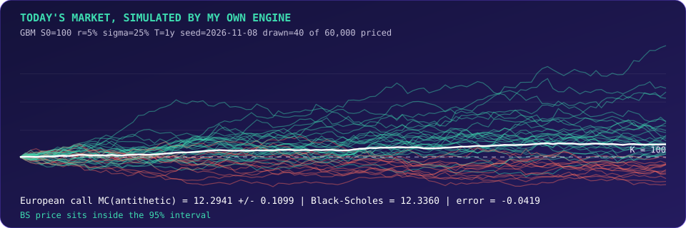
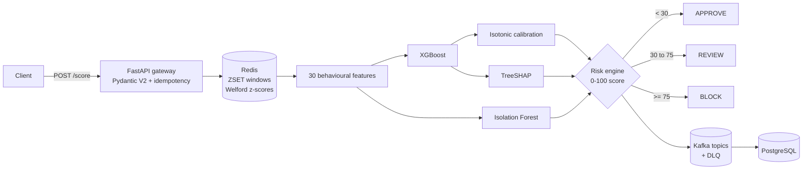
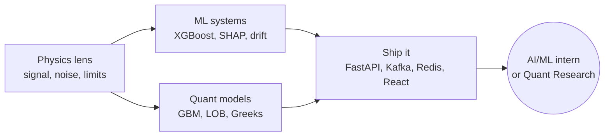

<div align="center">


<a href="https://git.io/typing-svg">
  
</a>

<br/>


</div>

---

## `$ python sajid.py --explain`

```python
class MDSajidAhmad:
    """Physics undergrad who treats every system as signal + noise."""

    base      = "SVNIT Surat, Integrated M.Sc. Physics (2024 - 2029)"
    thinks_in = ["probability", "stochastic calculus", "information theory"]
    ships_in  = ["Python", "C++", "TypeScript", "SQL"]

    def proven(self):
        return {
            "ml_in_production_shape": "fraud engine: Kafka, Redis, XGBoost, TreeSHAP, React",
            "quant_models":           "LOB simulator + Monte Carlo exotic options pricer",
            "client_work":            "full-stack marketplace, 11 months, real users' money flows",
        }

    def honesty_policy(self):
        # every number below is labelled: real, simulated, or synthetic
        return "I tell you what the data is. I tell you what the backtest can't prove."

    seeking = ("AI/ML internship", "Quantitative research role")
```

---

## 🎲 Today's market, simulated by my own engine

<sub>This image is regenerated every day by a GitHub Action running pure-Python Monte Carlo (antithetic variates) against the closed-form Black-Scholes price. If you are reading this tomorrow, the paths are different. The pricing error is live.</sub>

<div align="center">
  
</div>

---

## 🧪 Flagship projects

<table>
<tr>
<td width="50%" valign="top">

### 🛡️ Real-Time Payment Fraud Engine
`Python` `FastAPI` `XGBoost` `Kafka` `Redis` `PostgreSQL` `TreeSHAP` `React 19`

A streaming risk engine that turns raw card transactions into **APPROVE / REVIEW / BLOCK** decisions, with an explanation for every call.

| | |
|---|---|
| Champion XGBoost PR-AUC | **0.9825** |
| Isotonic calibration ECE | **0.0014** |
| End-to-end p95 latency | **92 ms** (250 live requests) |
| Automated tests | **61 / 61** |
| Commits | **114** |

**[→ Repository](https://github.com/ahmadmdsajid129/real-time-payment-fraud-detection)**

</td>
<td width="50%" valign="top">

### 📉 LOB Simulator & Market-Making Engine
`Python` `Pandas` `NumPy` `XGBoost`

An event-driven limit order book, microstructure features, an XGBoost alpha model, and a backtest that **stress-tests its own edge** with adverse selection.

| | |
|---|---|
| Order handling | O(1) `deque` queues |
| Features | OBI, micro-price, spread |
| Validation | strict chronological split |
| Out-of-sample accuracy | ~**67%** (simulated feed) |
| Key finding | edge dies when crossing the spread |

**[→ Repository](https://github.com/ahmadmdsajid129/lob-alpha-simulator)**

</td>
</tr>
<tr>
<td width="50%" valign="top">

### 🧮 Exotic Options Pricing Engine
`Python` `FastAPI` `NumPy` `Next.js` `TypeScript` `Recharts`

Monte Carlo pricer for **European, Asian and barrier** options under GBM, with variance reduction and Greeks, behind a trading-desk-style dashboard.

| | |
|---|---|
| Variance reduction | antithetic + control variates |
| Sanity check | compared with Black-Scholes |
| Greeks | Delta, Vega (finite difference) |
| Interface | live path + risk visualisation |

**[→ Dashboard repo](https://github.com/ahmadmdsajid129/exotic-options-client)**

</td>
<td width="50%" valign="top">

### 🏔️ HimaVogue (client work)
`Next.js 14` `Node.js` `MongoDB` `Redis` `Docker` `eSewa`

A multi-vendor e-commerce platform I built as a freelance developer (Aug 2025 to Jul 2026): JWT + role-based auth, split-order logistics, vendor KYC, **commission and escrow ledger**, a bespoke-tailoring pipeline, and a Redis cache-aside layer.

| | |
|---|---|
| Roles | customer, seller, admin |
| Money flow | order, escrow, settlement, payout |
| Caching | Redis, graceful DB fallback |
| Delivery | 3-stage Docker build |

</td>
</tr>
</table>

<details>
<summary><b>🔬 Under the hood: fraud engine pipeline</b></summary>



Design choices I would defend in an interview:

- **Zero temporal leakage.** Chronological splits, and Redis state is committed only *after* the current transaction is decided.
- **Cost-aware threshold.** Not 0.5. The cutoff minimises `FN x (amount + chargeback) + FP x insult cost`.
- **Explainability on every decision**, with PSI and KS drift monitoring across all 30 features.

</details>

<details>
<summary><b>🔬 Under the hood: what the LOB backtest taught me</b></summary>

A naive mid-price backtest looked great. Then I added the frictions:

1. Cross the spread and pay taker fees: **the edge disappears.**
2. Pivot to passive quoting with simulated **adverse selection**: ~35% fill on winning quotes, 100% fill on losing ones.
3. Use model probability (>60%) only to choose *which side to quote*, a defensive use of alpha.

The lesson was the point of the project: a Sharpe ratio means nothing until you have tried to destroy it.

</details>

---

## ➗ The math I actually use

<table>
<tr>
<td width="50%" valign="top">

**Pricing: Geometric Brownian Motion**

$$dS_t = rS_t\,dt + \sigma S_t\,dW_t$$

$$S_T = S_0\exp\!\Big[\big(r-\tfrac{\sigma^2}{2}\big)T+\sigma\sqrt{T}\,Z\Big]$$

$$\hat C = e^{-rT}\,\frac1N\sum_{i=1}^{N}\tfrac12\Big[(S_T^{+}-K)^+ + (S_T^{-}-K)^+\Big]$$

<sub>Antithetic pairs use $Z$ and $-Z$. Control variate: $\hat C_{cv}=\hat C-\beta(\hat Y-\mathbb E[Y])$.</sub>

$$\Delta \approx \frac{C(S_0+h)-C(S_0-h)}{2h}$$

</td>
<td width="50%" valign="top">

**Microstructure signals**

$$\text{OBI}=\frac{V_b-V_a}{V_b+V_a}\qquad P_{\text{micro}}=\frac{P_bV_a+P_aV_b}{V_a+V_b}$$

**Fraud risk arbitration**

$$S=100\big(0.55\,P_{\text{ML}}+0.15\,S_{\text{anom}}+0.15\,S_{\text{beh}}+0.15\,S_{\text{rules}}\big)$$

**Explainability (TreeSHAP)**

$$f(x)-\mathbb E[f]=\sum_{j=1}^{M}\phi_j(x)$$

</td>
</tr>
</table>

---

## 🧬 In the lab right now: **Oddly** *(codename, in design)*

> **Someone out there is oddly like you.**

A daily five-pick game, the same five questions for everyone on Earth, that finds the one stranger who answered most like you. No chat, no profile, a 30-second ritual with a shareable result. I am designing it as a **web-first PWA**, then native.

The part I am enjoying most is the maths. Matching on a rare answer should count for more than matching on a coin flip, so each answer is weighted by its information content:

$$I(a)=\log_2\frac{1}{p(a)}\qquad S(u,v)=\frac{\sum_q w_q\,s_q}{\sum_q w_q},\quad w_q=\frac{I(a_u)+I(a_v)}{2}$$

And a result I derived and checked by simulation: with $N$ daily players and a question set of entropy $H$ bits, the expected number of exact twins is about

$$\mathbb E[\text{exact twins}]\approx\frac{N}{2^{H}}$$

so the question set has to grow with the crowd, or "your perfect twin" stops meaning anything. *(Status: blueprint and simulations done, build starting. Nothing validated with real users yet, and I say so.)*

---

## 🛠️ Arsenal

<div align="center">

**Quant & ML**


**Backend & Data**


**Frontend**


**Tools**


</div>

---

## 📊 Commits, streaks, and the whole history

<div align="center">


<picture>
  <source media="(prefers-color-scheme: dark)" srcset="https://raw.githubusercontent.com/ahmadmdsajid129/ahmadmdsajid129/output/github-snake-dark.svg" />
  <source media="(prefers-color-scheme: light)" srcset="https://raw.githubusercontent.com/ahmadmdsajid129/ahmadmdsajid129/output/github-snake.svg" />
  
</picture>

<br/>


</div>

---

## 🧭 How I work



- **Label the data.** Synthetic, simulated or real, it is written next to every number.
- **Try to break it first.** Chronological splits, adverse selection, drift checks.
- **Make it explain itself.** SHAP in the fraud engine, error bars in the pricer.
- **Then build the interface**, because a model nobody can use is a notebook.

<details>
<summary><b>🏋️ Off the keyboard</b></summary>
<br/>
Deadlifts and bench press, working on the bulk. Progressive overload and gradient descent turn out to be the same idea.
</details>

---

## 📫 Let's talk

I am looking for an **AI/ML internship** or a **quantitative research** role. If you have a problem with noisy data and a hard latency or risk constraint, send it over.

<div align="center">
  <a href="https://www.linkedin.com/in/md-sajid-ahmad-350a9b32a/"></a>
  <a href="mailto:ahmadmdsajid129@gmail.com"></a>
</div>


